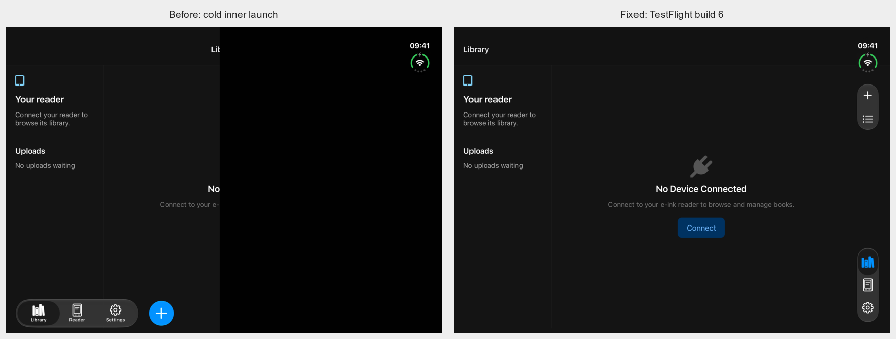
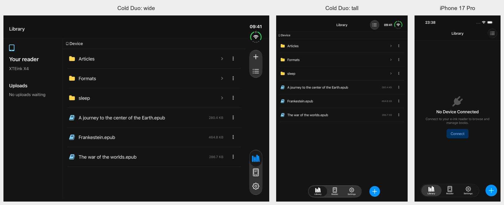

# Duo cold inner-display launch

A cold launch with the hinge already open clipped the app at the outer display's width and left a blank right half. Opening outer first and then unfolding repaired the layout because UIKit received a resize. This is a separate bug from the outer display's white top strip; both fixes are included in this branch.

## Reproduction and cause

Reproduced on the iOS 27.1 Duo simulator with the physical hinge opened before terminating/launching the app. The dark screenshot matches the reported clipping and misplaced bottom capsule. The same defect appears in light appearance.

The scene, window, React root and native tabs' React host all measured **951 × 669 points**. The embedded native tab controller remained **466 × 678**, so its clipping and native navigation placement used the outer display's default geometry. The child React screens already measured 951 × 669; changing JavaScript breakpoints would not repair the native containment.

A debugger-only experiment set the existing tab controller view's frame to its host's bounds. That immediately revealed the full content and restored the system's right rail. No screen was recreated.

## Change

`ReaderBottomBar.attached(to:)` fits the existing controller to its actual, nonempty host bounds before inspecting native bar placement. The existing flexible width/height behavior follows subsequent resizes. There are no device-model checks or orientation breakpoints, and no scene/root recreation. The earlier full-size themed tab wrapper remains in place for the outer white-strip fix.

The standalone `scripts/test-duo-cold-launch.py` prepares the physical display before launching and checks the active display through idb. It terminates between cases, without allowing a post-launch resize to mask the bug. Inner wide uses the system rail; inner tall uses the system's bottom placement, with Add alongside navigation. See `.maestro/visual-tests/duo-cold-inner.md` for expectations.

## Validation

- The committed regression check rejects the saved pre-fix active-display snapshot: tabs are still at the bottom inside the outer-sized native controller.
- Final Release simulator build **1.5.0 (6)**: cold outer, inner wide and inner tall in both appearances, all three destinations. **18/18** tab checks and **18/18** top-edge pixel checks passed; the accompanying JSON records measured geometry.
- Outer → inner wide → inner tall → partial hinge → outer: **30/30** top-edge appearance checks. Native placement follows the system through these resizes.
- The complete folder draft “Cold launch fold draft” and `/Formats` destination survived fold/unfold and partial-hinge steps in one process, then were cancelled. The native modal retained its wide geometry during the attempted inner-tall rotation; actual measured frames are retained in local evidence.
- Regular iPhone (iOS 26.5): **3/3** native actions, separate Add and appearance flows passed; **8/8** top-edge pixel checks.
- Android API 36: **6/6** selected flows passed, including the actual landscape keyboard. The unchanged Android 1.5.0 APK was freshly installed; this fix changes only iOS native code and iOS release metadata.
- Basic suite passed. Simulator Release build, arm64 archive, all three bundle versions, distribution profiles, reader assets and deep/strict package signatures passed. Hermes disassembly matches the tested simulator after normalizing the single debug filename entry.

The initial Android attempt used port 8084, but its virtual-keyboard helper enters the standard 8082 address. That setup failed; the final six-flow run uses a separate disposable mock on 8082. A draft check also started folding before text injection finished; the final check waits for the complete value before any hinge command.

Maestro could not validate cold inner launch: its current iOS driver captured the inactive outer display as black and returned incorrect coordinates. The new regression therefore uses the active-display-aware idb API for both screenshots and geometry, while regular iPhone flows still use Maestro. Neither of the cold-inner Maestro attempts is counted as an app pass.

## Release

**TestFlight 1.5.0 (6) is available.** Apple completed processing at 2026-11-10T07:51:11+00:00 and confirmed availability at 2026-11-10T07:51:24+00:00. Production source: `82730ad49c8e807a1ea71b116d079f01ac92a157`. No App Store review submission was made.

[Machine-readable validation](duo-cold-inner-validation-2026-11-09.json).

