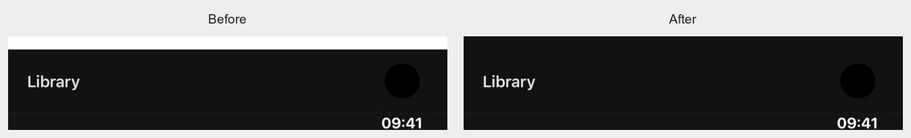
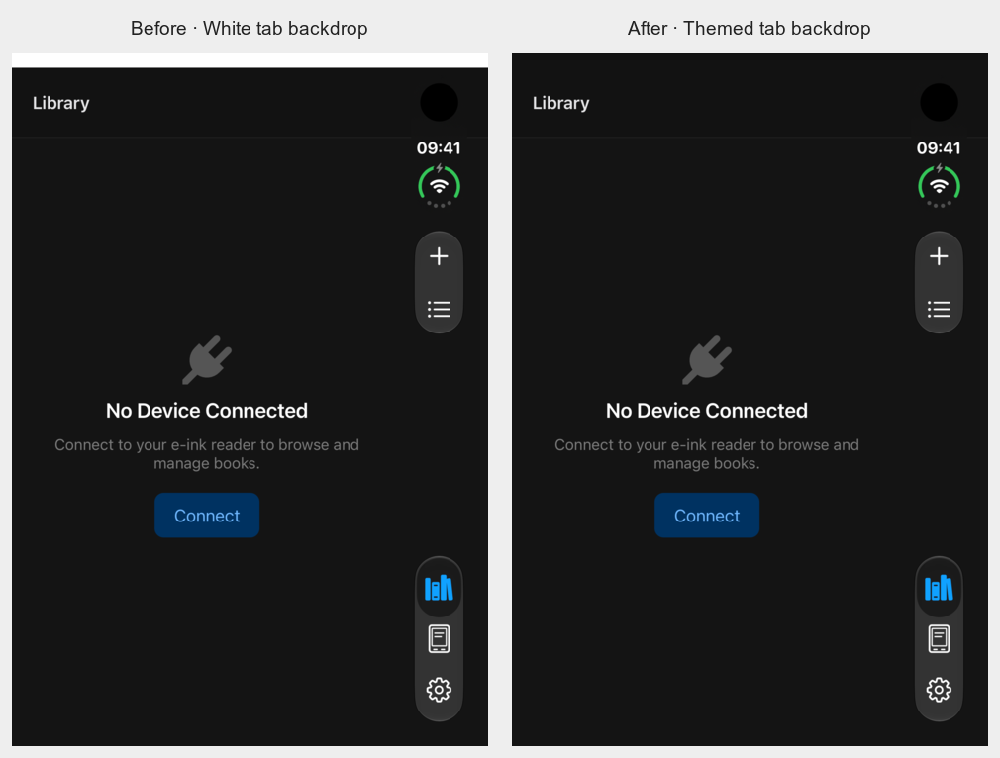
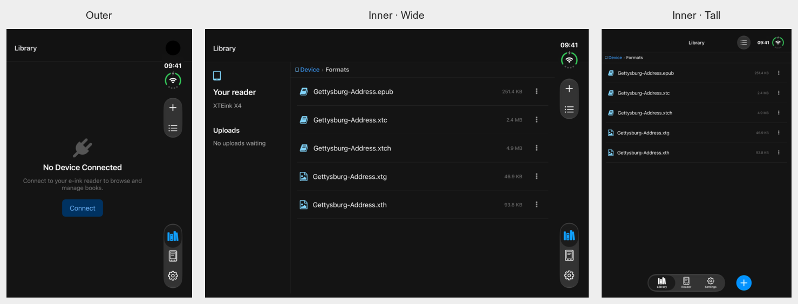

# Duo outer-display dark-mode strip — November 9, 2026

The reported white strip reproduces on the iPhone Duo simulator running iOS 27.1. The original outer-display capture has a 42-pixel / 14-point white band above the dark navigation header. It is also visible in the previous committed dark reference; the earlier visual review missed it.

## Cause and fix

React Native Screens 4.16 initializes `RNSBottomTabsScreenComponentView` with a hardcoded white background as a scroll-edge workaround. Native debugger inspection showed that the app root already used the adaptive system background. On the outer display, the navigation bar starts at y24 points and its background extends upward by 10 points, leaving 14 points of the tab's white backdrop visible. A temporary debugger-only change to that backdrop's layer color changed the exact strip, confirming the responsible layer.

`NativeTabScreen` now keeps a full-size React Native `View` around its navigator, using the current React Navigation `colors.card` surface. This fills the exposed area with the same color as the header. The existing navigator stays mounted, and UIKit keeps controller containment, rail placement and safe areas. No native navigation implementation or dependency is patched.

## Verification

The new flow 20 checks Library, Reader and Settings after a cold dark launch and hot appearance changes. `scripts/check-native-surfaces.cjs` checks the actual top-edge pixels and runs automatically when those captures are present. It fails on the original image with RGB 255/255/255 and passes the fixed dark surface with RGB 18/18/18. Light surfaces measure RGB 255/255/255. ImageMagick is required for this native visual check.

- The complete initial Duo suite passed **20/20**, including all eight appearance pixel checks.
- The initial complete iPhone run passed **19/20**. Its new appearance flow could not find a UIKit tab identifier after changing appearance in Settings. The native labels and controls remained present. The final appearance flow follows those stable, user-facing labels; the final iPhone native action, bottom Add and appearance flows passed **3/3**, including **8/8** pixel checks. These are separate runs, not a claim of one clean 20/20 iPhone run.
- The final Duo hinge/rotation audit exercised outer, wide inner, tall inner, partial fold and outer return. All three destinations were opened in both appearances: **30/30** top-edge checks passed. Library retained `/Formats`, and the action/destination controls remained distinct and correctly grouped. Native tab labels select the actual radio buttons using freshly read accessibility frames during this probe.
- The exact `Dark surface fold draft` text and `/Formats` destination survived five display poses in one app process. Create, Cancel and Close stayed clear of the keyboard in the reviewed captures. The draft was cancelled.
- A fresh Android Release APK passed **6/6** selected regression flows: setup, connection, connected Library, Add menu, dark appearance and the reopened-landscape-keyboard check. Keyboard settings were restored afterward.
- The basic suite and **7/7** runner checks passed. Typecheck retains **106** baseline Tamagui diagnostics, with no new diagnostics in this change.

The initial full native suites and Android build used the same production application source as the final fix; later changes refine test selectors and documentation. Temporary native identifier experiments were removed. Earlier attempts are retained separately: a filtered workspace was rejected by Maestro ordering before execution, native tab-ID probes were unsuccessful, and one archive ran out of local storage. Disposable caches were cleared before the successful final archive and export.

These are native simulator/emulator UI checks with disposable mock readers. No reader API or generated-content behavior changed, so firmware-simulator validation was not required. They do not claim verification on a physical Duo. The user's real-device screenshot was used for diagnosis; the public figures are our own simulator captures.

## TestFlight release

Release source is `fbd514a7b495a1bd8c7fd1d470f93552ab22fb6d`, with version **1.5.0 (5)** in the app and both extensions. The arm64 production archive passed with Xcode 27.2 / iOS SDK 27.2. App Store distribution profiles, reader icon resources and deep/strict package signatures passed verification. The executable Hermes bytecode matches the final simulator build after accounting for its debug output filename.

App Store Connect accepted the upload at **2026-11-10 07:09:26 UTC**. Apple confirmed processing completed at **2026-11-10 07:11:44 UTC** and availability in internal TestFlight at **07:12:05 UTC**. The upload retains the existing missing third-party dSYM warnings for React, ReactNativeDependencies and Hermes. No App Store review submission was made.

[Structured validation and release provenance](duo-outer-dark-strip-2026-11-09.json). Raw captures, JUnit results and pixel reports are in `test-screenshots/duo-dark-strip/`; local build, debugger, audit and upload logs are under `.local/duo-dark-strip/` and `.local/testflight-1.5.0-build5-final/`.
