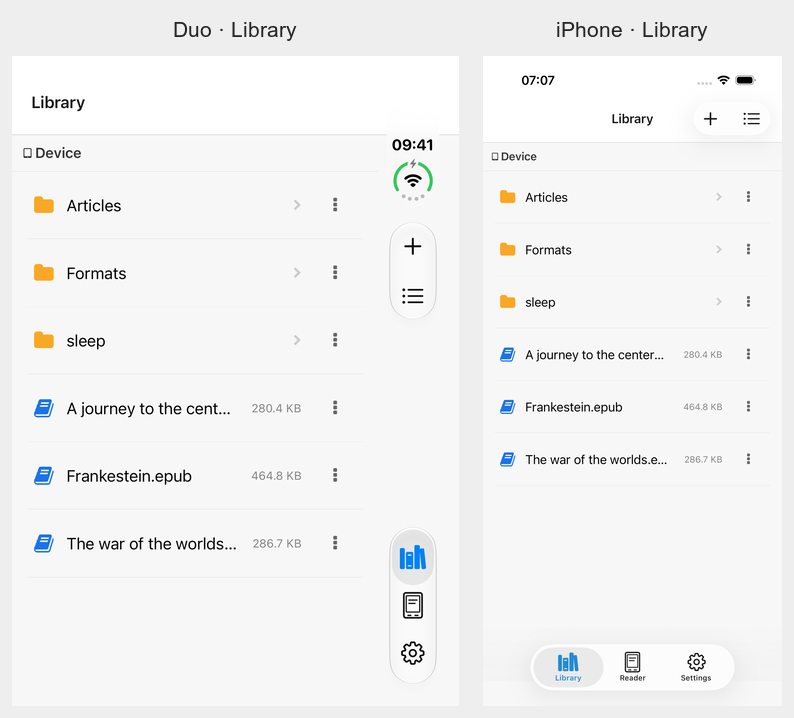
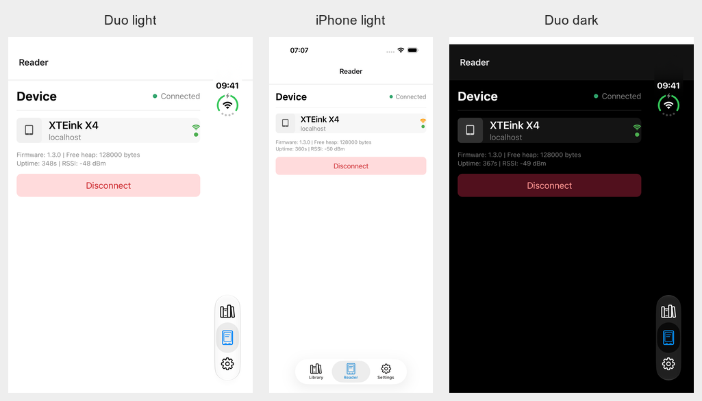
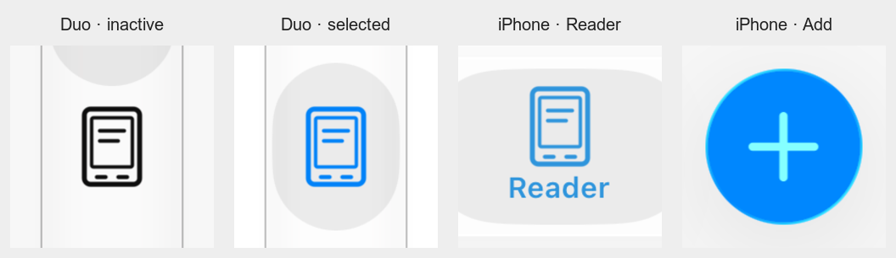

# Native iPhone Duo validation — November 4, 2026

The iPhone Duo simulator is installed and native validation is complete. The new [70-second native demo](videos/2026-11-04/iphone-duo-native-demo.mp4) shows the actual running app on both displays, including software keyboards, a live upload and fold transitions. The reader is a local mock using public-domain and synthetic fixtures.

## Installed environment

- macOS 27.2 (26B123), updated by the user.
- Xcode 27.2 (27B52), installed from Apple's App Store. The user completed sign-in, license acceptance and required first-launch setup.
- iOS Simulator SDK 27.2 (24B8118); installed iOS 27.1 runtime (24A94425).
- Device type `com.apple.CoreSimulator.SimDeviceType.iPhone-Duo`, model `iPhone19,4`.
- Dedicated simulator `CrossPoint Duo Validation`, UDID `32516D8C-95E0-4128-A749-A87E641CB0A9`.
- Actual active display captures: outer 1398×2034 pixels; inner 2853×2007 or 2007×2853 depending on pose. Layout decisions use current app space rather than these device dimensions.

Apple documents the SDK-dependent presentation and asymmetric safe areas in [Prepare your app for iPhone Duo](https://developer.apple.com/iphone-duo/prepare/). [Scene lifecycle adoption](https://developer.apple.com/documentation/uikit/transitioning-to-the-uikit-scene-based-life-cycle) is required for apps linked with the iOS 27 SDK.

## Native changes and findings

`plugins/withSceneLifecycle.js` makes the generated Expo project adopt scenes while preserving Expo dev-launcher ordering: prepare the existing React window/root before app-delegate subscribers run, then attach that same window to the scene. Folding resizes the existing tree. Cold/warm URLs and Expo lifecycle subscribers are forwarded. It also raises older pod resource deployment targets to the app's existing iOS 15.1 minimum, resolving two Xcode 27 build errors. Repeated Expo generation retained one scene delegate, one React startup and one deployment-floor block.

Native review found one additional layout defect: the crop screen's first full-screen presentation inherited zero safe-area insets. Even five seconds after opening, Done occupied the outer system region at x383.67–448 points. A modal-local `SafeAreaProvider` fixes the initial presentation: Done is x299.67–364 and the canvas is 382 points wide, before any fold. The standalone native Maestro check actually tapped Done and returned to Library. The format line now says “Grayscale output,” accurately describing the exported image while the native source preview can remain in color.

## Completed checks

- Release and Debug builds with Xcode 27.2 passed. Compiled Release `DTSDKName` is `iphonesimulator27.2`.
- Development launcher, warm/cold Metro URLs, interaction and Settings continuity across folds passed. Release cold Settings link passed.
- Full Duo Maestro run: 16 of 17 passed. The adaptive flow left the old extension after a center-positioned caret; its corrected setup taps at 95% and asserts the exact draft before rotation. That targeted flow then passed. These are separate runs, not a claim of one clean 17/17 run.
- Actual hinge changes 0 → 180 → 90 → 0 retained the same app process, folder and scroll anchor. Reading list 15 returned at exactly y147.6667 points.
- File actions stayed open. The exact rename draft stayed readable with its keyboard across all poses. Compact outer landscape also kept the full field and actions accessible.
- Move retained destination `/Articles` and the typed “Reading drafts” folder name through opening/closing. No move or folder creation was submitted.
- Off-center crop content stayed constant after the safe-area fix. Normalized native crop pixels had mean absolute differences of 0.1700 for inner/partial and 0 for the return, on a 0–255 scale. Cancel and Done cleared system UI in every reviewed pose.
- A 17,719,257-byte native upload remained one job and one WebSocket start through folds. Progress advanced 23% → 34% → 44%, then completed. Destination bytes matched SHA-256 `0b7510d92c5694e7f1675a4676b9429d133d11087b06c4ea4def4d5cdb40b039`.
- iPad Pro 11-inch M5 / iOS 26.5: the new scene-based build launched, connected, navigated Settings and opened a keyboard dialog successfully. The final crop fix also passed on its first tablet opening: Done clears the top system bar. Earlier native tablet portrait/landscape coverage remains in the broader validation report.
- Native Debug Logs empty state and header actions cleared the system region. Populated log wrapping was not re-tested.
- Four adaptive component/geometry checks and the full shared browser resize matrix passed after the crop fix. Typecheck still reports the same 101 known Tamagui RC prop-definition errors; project-wide typecheck is not clean.

The independent [design review](iphone-duo-design-review-2026-11-04.md), [structured native results](native-duo-validation-2026-11-04.json), and reviewed references in `test-references/ios/iphone-duo/light/` retain the evidence. This is simulator/mock-reader validation; no physical Duo or physical reader was used.

## Recording and test setup

The video is a continuous native display recording, trimmed to the outer starting view. Captions and a display-fitting presentation zoom make both physical display shapes readable. Normal short simulator display handoffs remain visible. The rename and crop are cancelled in the recording. A second native upload in the recording also completed once with matching bytes.

Upload jobs were seeded in the dedicated simulator's test store before launch; the actual native file reader, queue and WebSocket transport performed the transfers. A local proxy slowed binary frames by 10 ms per 4 KiB frame (64 KiB acknowledgement windows). Earlier proxy attempts were discarded after correcting ws-version binary flag handling and an overly slow per-frame delay. No uploader or device protocol code was changed.

The native picker rendered, but the test tool could not consistently scope its remote accessibility window; the seeded-job test avoids making a claim of automated native picker selection. Source fixtures and all staging are disposable local test data.

Key local logs: `.local/duo-sdk27-release-build-recheck.log`, `.local/duo-sdk27-debug-build.log`, `.local/duo-sdk27-native-suite.log`, `.local/duo-sdk27-adaptive-recheck.log`, `.local/duo-crop-initial-safearea.log`, `.local/duo-crop-safearea-fold-recheck.log`, `.local/duo-upload-final-check.log`, and `.local/duo-native-demo/recording.json`. Earlier setup downloads are retained in `.local/duo-install-cache/`.

To repeat, boot the dedicated simulator, start the disposable mock reader (HTTP 8082 / WS 8083), install the Release build, and use the native test flows. The standalone `.maestro/manual-flows/sleep-preview-safe-area.yaml` requires a staged local image route and submits that test image. Use the idb physical `rotation`/`hinge` APIs and wait for the presentation to settle; do not infer layout from an intermediate framebuffer or an orientation-space AX root frame alone.

## Final workspace state

The dedicated Duo and tablet test simulators were shut down after verification, and task-owned mock/proxy, Metro, web-server and test-companion processes were stopped. The Duo device, runtime and final Release app remain installed. The Duo's saved test address was restored to `localhost:8082` for a normal mock-reader rerun. Source changes and review artifacts are on `codex/iphone-duo`.

## Native system rail follow-up — November 8, 2026

Starting from `main` at `e7c93ec`, iOS 27.1+ now uses Expo's native tabs and a native navigation stack for each tab. The local `reader-toolbar` Expo module installs standard navigation-bar items for Add, reader connection and uploads. UIKit places those items and Library/Settings in the system rail on the outer and wide inner displays, and uses horizontal bars in the tall inner pose. The decision does not use a phone model or a width breakpoint. Older iOS builds, Android and web retain their existing adaptive navigation.

Library and Settings respect both lateral safe areas with native bars. The expanded reader context keeps its status summaries while its connection/queue buttons move into the rail. Native actions retain the existing accessibility identifiers; the Add menu keeps Upload Files, connected-only New Folder and Sleep Background. Unchanged status polls retain the same native items so an open menu is not recreated.

Validation used Xcode 27.2, the iOS Simulator 27.2 SDK and the dedicated Duo simulator on iOS 27.1:

- The final Release build passed. iOS and Android Metro exports passed.
- Three targeted Maestro flows passed: connected Add menu, disconnected Add menu, and native actions/navigation. The native flow opens/cancels New Folder, opens/closes the queue and switches both tabs. Reviewed menu and native-bar references are in `test-references/ios/iphone-duo/light/`.
- A live native probe retained the exact folder draft through outer, wide inner, tall inner, partial fold and outer return in one app process. After cancelling, the Formats folder remained selected through those display changes, outer landscape and a Settings round trip. File actions cleared the rail on either physical edge. All folder operations were cancelled.
- The four adaptive checks and the final browser resize matrix passed. Typecheck produced the same 106 diagnostics as an isolated copy of the starting `main`, with no new diagnostics.

Native artifacts are under `test-screenshots/duo-right-rail/`; local build and probe logs are under `.local/duo-right-rail/`. The firmware simulator was not needed for this UI-only change. These checks do not claim physical-device or reader-transfer validation.

The new module requires rebuilding the iOS app; an older development client without it retains the previous navigation. Regenerate with `npm run prebuild -- --platform ios`, then build with `npm run ios`. The committed native action check is `.maestro/flows/18-native-reader-bars.yaml`; use a connected disposable mock reader.

## iOS 26 glass menus and revised grouping — November 9, 2026

The native path now starts at iOS 26, independently of Duo's iOS 27.1 vertical-bar support. Add appears before Uploads in the action group. Library, Reader and Settings form the destination group. Reader is a real management page that shares its existing form with the connection sheet used by older builds. Its tab uses a plain reader outline with no connection dot or notification badge; connection status appears inside the page. The WiFi navigation icon was removed, and Uploads uses a queue/list symbol.

The final Release build passed with the iOS Simulator 27.2 SDK. Five targeted native flows passed on each of **Duo/iOS 27.1** and **iPhone 17 Pro/iOS 26.5**, for **10/10** total. They cover connecting/disconnecting, the idle Reader form, connected/disconnected native Add menus, cancelled New Folder, uploads, Reader and Settings navigation. The iPhone connection test taps Connect with the actual URL keyboard open; it does not rely on Maestro's unsupported keyboard-dismiss action for that page. Native-bar identifiers are refreshed after layout as well as prop updates.

Native Duo captures verify Add/Uploads and Library/Reader/Settings order without group overlap in outer, wide inner, tall inner, partial-fold, outer landscape and outer-return poses. The Formats folder remains selected through these display changes. The exact Reader address draft survives five poses in one process. The disposable address was restored and the app reconnected; returning to the Library root after an explicit disconnect is expected. Recorded snapshots and the final restored state are audited in `test-screenshots/native-menu-ios26/duo-folds/result.json`.

The browser resize matrix also passes after exercising the shared legacy connection sheet through disconnect, reconnect and automatic dismissal. Four adaptive checks and both iOS/Android bundle exports pass. Typecheck retains 106 known Tamagui prop diagnostics; moving the shared form changes their file locations and one conditional-child type description, with no new diagnostic category.

Artifacts are under `test-screenshots/native-menu-ios26/`, including `duo-verified/results.xml`, `iphone-final/results.xml`, raw screenshots and the `images/` comparison figures. Reviewed references were updated for both devices. Earlier attempts are retained separately: a full disk interrupted one run, resolved by removing disposable compiler caches; a stale Duo automation companion was restarted before the fold probe. These are simulator/mock-reader UI checks, with no physical-device or reader-transfer claim.

## Reader hardware icon — November 9, 2026

The Reader destination now uses a custom monochrome template inspired by [official XTEink X3 hardware imagery](https://www.xteink.com/products/xteink-x3): an inset display, two reading strokes and two horizontal bottom controls. It represents the reader family rather than one exact model. It has no connection dot or badge. UIKit supplies the inactive, selected and dark-appearance tints. The editable source is `assets/icons/reader.svg`; `npm run build:reader-icon` generates the three native PNG scales with ImageMagick.

The native navigation flow passed on Duo/iOS 27.1 and iPhone 17 Pro/iOS 26.5, and a separate Duo dark-appearance flow passed (**3/3**). These checks used the existing Release native binary with the updated Hermes bundle and icon assets; no native code changed for this icon. Android bundling passed, and typecheck retained the same 106 existing Tamagui diagnostics. The designer reviewed actual inactive and selected native captures across both devices and dark appearance and approved their clarity, weight and tint without further changes.

Updated light references are in `test-references/ios/iphone-duo/light/` and `test-references/ios/iphone-17-pro/light/`. Raw captures, native test results and the device/detail comparison images are under `test-screenshots/reader-icon/`. This was a UI-only change using a disposable mock reader; firmware behavior was unchanged.

Reviewed native screenshots (resized or cropped from simulator captures):

## TestFlight upload — November 9, 2026

Production version **1.5.0 (3)** was archived from source commit `22ad25db8b4c097c1ec076c512adfe49c66cc2ac` with Xcode 27.2 and the iOS 27.2 SDK. The archive contains the native ReaderToolbar module and all three final reader-icon scales. The app, Share Extension and Safari Web Extension all report version 1.5.0 and build 3. Their App Store distribution profiles have debugging disabled, and deep/strict package signature verification passed. The basic test suite also passed before publication.

App Store Connect accepted the upload. Apple's notifications confirmed processing completed at **16:05:30 UTC** and **1.5.0 (3) was available to test at 16:05:44 UTC** on November 9. The existing internal TestFlight group automatically receives Xcode builds. The upload reported missing third-party dSYMs for React, ReactNativeDependencies and Hermes, matching the earlier release's symbol warnings; the upload itself succeeded. Local provenance and signing/upload logs are retained under `.local/testflight-1.5.0-build3/`. No App Store review submission was made.
