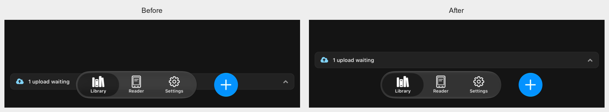
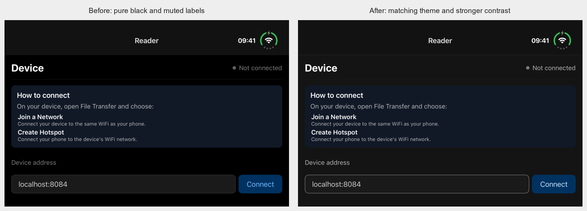

# Upload queue clearance and Reader theme

The native floating bottom navigation covered the upload queue row, and Reader used a pure-black surface while Library and Settings used the app theme. Both issues reproduced on the Duo simulator using the previous TestFlight build's simulator app.

## Changes

`ReaderBottomBar` reports the height actually covered by its bottom controls. Library reserves only the portion beyond its existing safe-area inset. The system rail reports zero bottom coverage. Placement follows the rendered native controls, with no device-model checks or fixed tab-bar height. The queue and current screen remain in the same React tree.

Reader now uses Tamagui's `theme.background`, matching both sibling destinations: RGB **20/20/20** in dark appearance and **247/247/247** in light appearance. Secondary labels and device details use gray 11; errors use red 11. The address field has a visible border and placeholder, primary/destructive labels use blue/red 12, and reader status/signal indicators follow the theme.

## Validation

- The saved pre-fix queue rectangle overlapped the bottom navigation by **45 points**. The final Duo bottom layout leaves **4 points** between the queue's complete hit area and the navigation targets, with the row's internal bottom margin providing additional visual spacing.
- Final Duo: **18/18** cold-launch destination/theme/pose checks, including a queued book in all six Library cases; **18/18** top-edge and theme-body pixel checks. Outer, inner wide and inner tall are measured individually.
- The queue opened and closed successfully on all three Duo poses, with no control overlap.
- The pre-fix Reader image fails the new body-pixel check at RGB **0/0/0**. Its header alone had passed the older check; the checker now verifies the body as well.
- **50/50** Reader color pairs passed: normal text at least **4.87:1**, field/indicator contrast at least **3.10:1**. The checks use [4.5:1 for normal text](https://www.w3.org/WAI/WCAG22/Understanding/contrast-minimum.html) and [3:1 for the field and indicator cues](https://www.w3.org/WAI/WCAG22/Understanding/non-text-contrast.html). These include both themes and button interaction colors. Input focus changes the border, not its fill, as defined by Tamagui's shared Input styles.
- Regular iPhone: offline queue flow **1/1** passed; the queue was opened and closed in both themes. The setup/native action/bottom Add/theme run passed **4/4**, with **8/8** top-edge/body checks. The final offline queue flow passed **6/6** pixel checks.
- Fresh Android arm64 APK: **6/6** selected flows passed, including connection, menus, dark appearance and the landscape keyboard.
- Basic suite and **7/7** visual-runner checks passed. Typecheck reports **108** Tamagui RC styling diagnostics: the prior 106 plus two missing `Button.color` prop declarations. Native bundles and runtime rendering accept these styling props.

A legal EPUB was staged directly into the persisted upload queue on disposable simulators for the offline geometry test. This is a UI fixture, not a reader-transfer compatibility claim; reader APIs and generated formats were unchanged. The iOS simulator's final palette was bundled using the project's standard Expo/Hermes Xcode phase after its native Release build. The archive's Hermes disassembly matches that tested simulator bundle after normalizing the single debug filename entry.

The first Android build exhausted disk space while restoring Gradle caches; the final arm64 build and six-flow run succeeded after cache cleanup. Initial iPhone accessibility startup failed before flow execution; a cold restart restored the native driver. An initial Duo matrix caught an unsettled simulator orientation; the final run waits for measured scene dimensions and passes without post-launch fold/rotation commands. An early offline-flow screenshot caught the normal appearance crossfade; the final flow exercises the queue after switching themes before recording stable references, and all six final pixel checks pass.

[Machine-readable validation](queue-reader-validation-2026-11-10.json).

## Release

**TestFlight 1.5.0 (7) uploaded successfully; Apple processing is pending.** Production source is recorded in the accompanying JSON.

