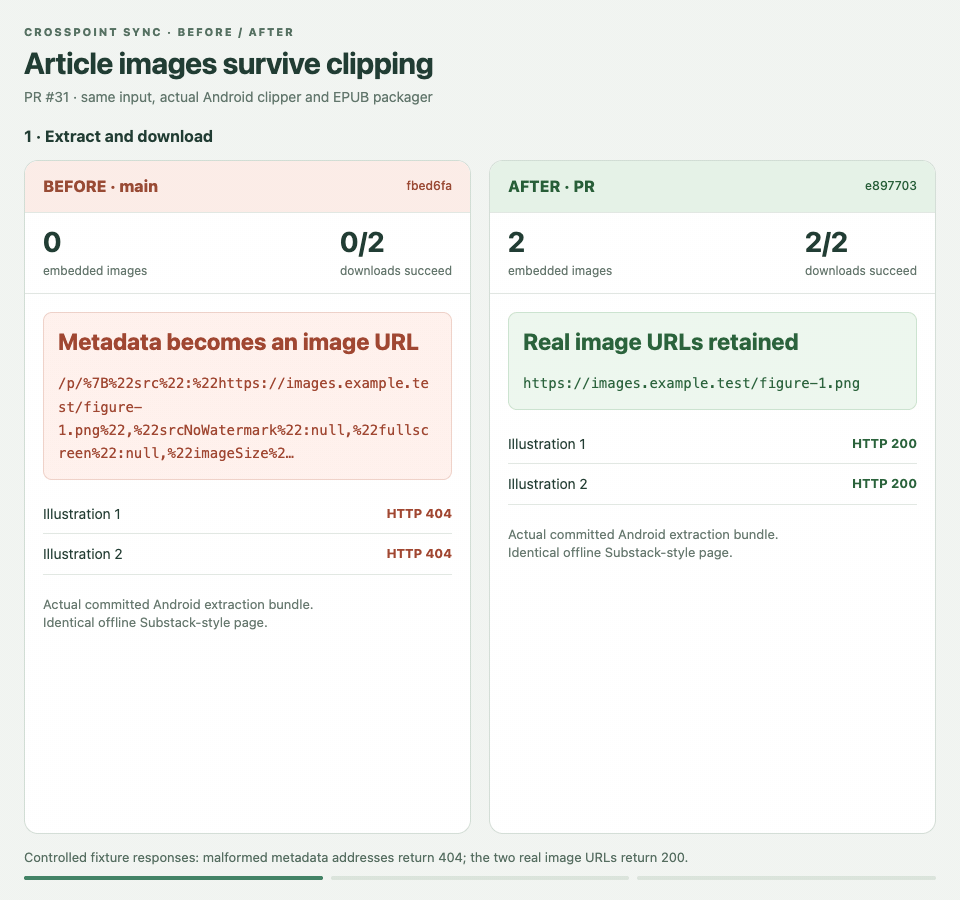
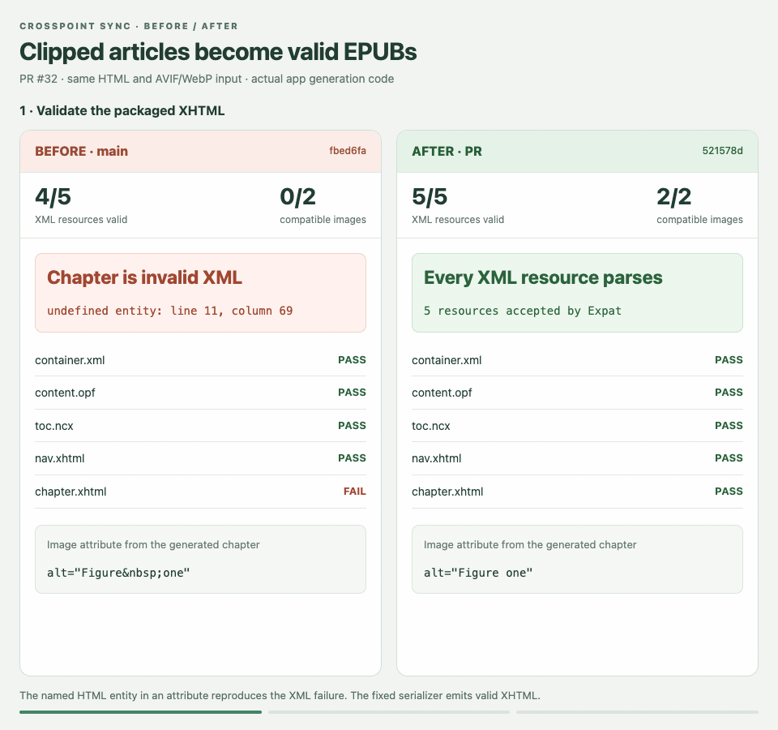
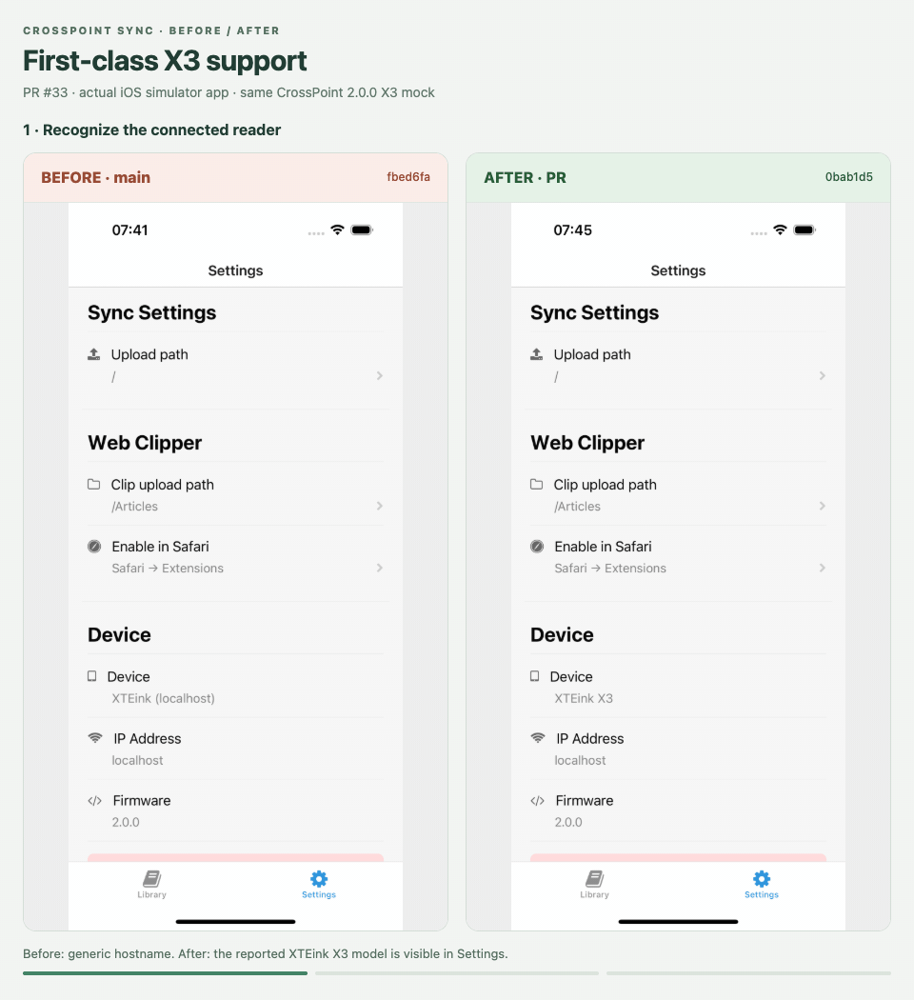
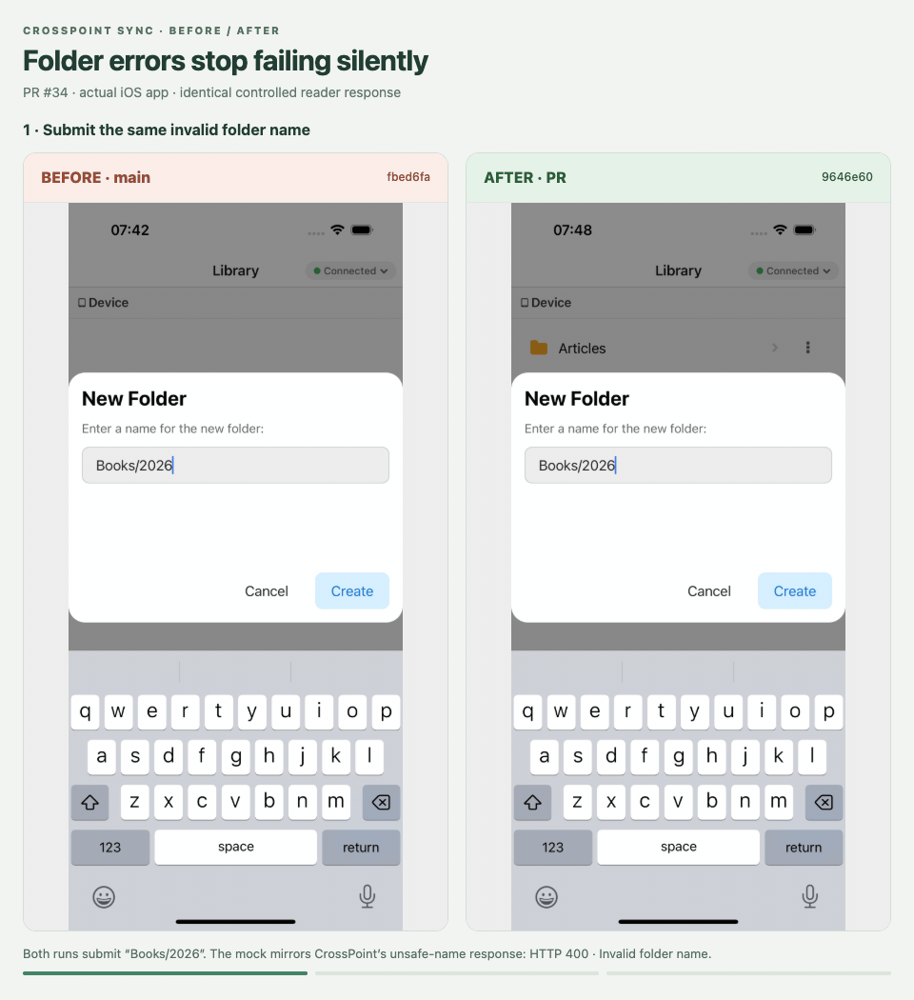
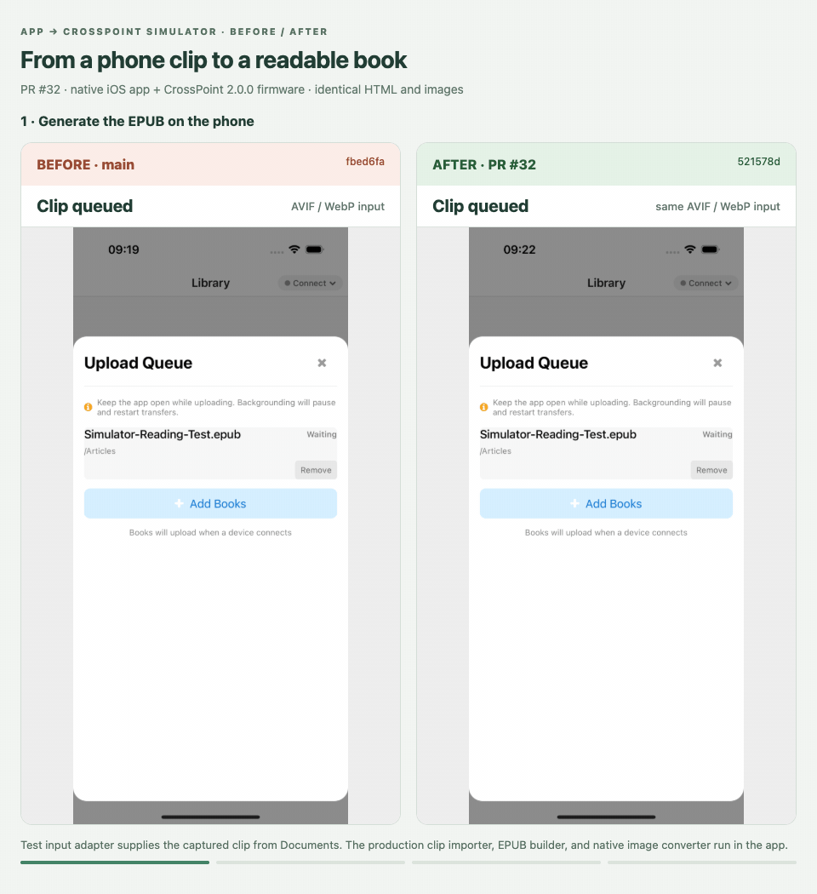

# PR before-and-after demos

Created November 8, 2026. This branch hosts media embedded in PR comments; it does
not change the application PR branches. All before captures use main `fbed6fa`.
Each after capture uses the exact PR head recorded in [evidence.json](evidence.json).
The JSON also includes outcomes, image MIME types, native BMP sizes, media hashes,
frame counts, and durations. All GIFs loop and contain multiple captured states.

## PR #31 — clipper images

Runs the **committed Android WebView extraction bundles**, then the production
EPUB packager, on an identical offline Substack-style regression page. Controlled
browser HTTP responses provide original demo illustrations at the two real image
URLs and 404 at malformed metadata URLs. Before: two failed downloads, zero
embedded images. After: two successful downloads and two embedded images. The
output is displayed in a browser EPUB-content preview, not physical-reader firmware.
This fixture specifically reproduces the Android extraction failure; it is not a
claim that every Safari page fails in the same way. The PR separately validates
the reported public Substack page in both pipelines.

## PR #32 — EPUB compatibility

Identical synthetic HTML includes `&nbsp;` in an image attribute and AVIF/WebP
illustrations. Both versions use their production EPUB builder; the after version
also runs the production preparation/converter adapter with browser codec and
filesystem adapters. Before: Expat rejects the chapter and the two image MIME
types are unsupported by the reader. After: all five XML resources parse and both
images are PNG, with the portrait image resized to the 1200-pixel limit. Browser
content previews are labeled. Native codecs and physical-reader rendering are
not demonstrated by this GIF.

## PR #33 — X3 support

Actual iPhone 16 Pro simulator captures (iOS 18.4), connected to the same mock
CrossPoint 2.0.0 X3 reader. Reused the installed native release shell with each
version's freshly exported Hermes bundle; these PRs make no native-source changes.
Settings changes from a generic hostname to XTEink X3. The same selected image
uses a 480×800 crop before and 528×792 after. Both runs execute native image
conversion and WebSocket upload. Downloaded BMP headers and sizes are verified:
480×800 / 1,152,054 bytes before, 528×792 / 1,254,582 bytes after. Physical X3
rendering is not tested.

## PR #34 — folder errors

Actual iOS app captures with the same invalid folder name, `Books/2026`. A
controlled mock reader mirrors CrossPoint 2.0.0's unsafe-name response:
`400 Invalid folder name`. Before, the dialog closes and no error appears. After,
the file browser displays the creation error. A separate direct invocation of
the production API confirms that main resolves the request while the PR rejects
it with `Create folder failed (400): Invalid folder name`. Existing-directory
verification and rejected-path caching are covered by the PR's protocol tests.

## Capture and encoding

Captured the native app with Maestro and the labeled evidence views with
Puppeteer, using the actual outputs and controlled input fixtures described above.
Composed before/after comparisons from the captures and encoded with FFmpeg at
5 fps using a generated GIF palette. Reviewed key frames and checked GIF frame
counts, durations, and file signatures. No physical-reader screen is simulated.

## Additional PR #32 app-to-firmware validation

[Native iOS app → real CrossPoint firmware simulator: results, GIF, inputs and logs](simulator-pr32.md).

