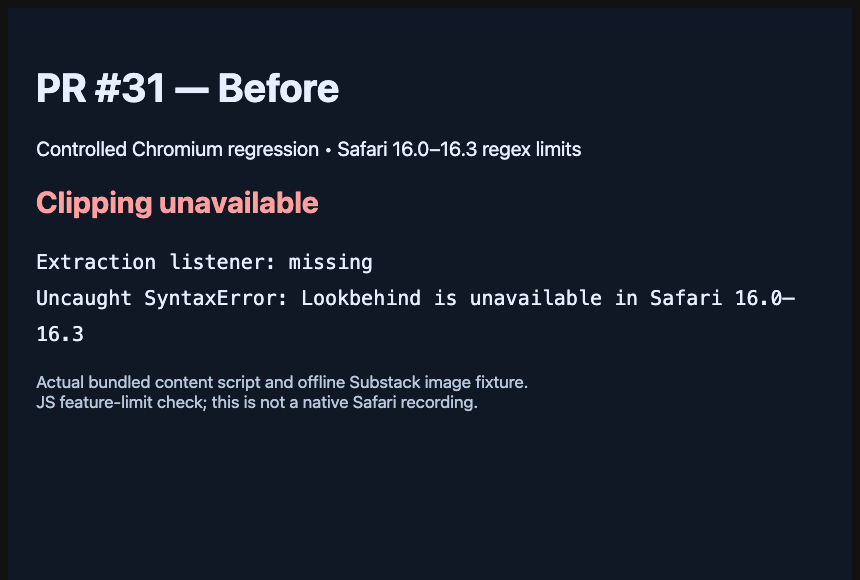

# Safari compatibility review fix

PR #31 originally initialized Defuddle 0.19.6 before registering the content
script listener. Its lookbehind regexes fail on supported Safari 16.0–16.3.
Commit `452cf0c` defers initialization and uses the pinned previous extractor
when the engine rejects the feature probe. Both paths retain the shared image
normalizer and DOMPurify sanitization.

This GIF shows results from the actual minified Safari content script, bundled
with the production Safari 16 target, against the same offline synthetic
Substack fixture. A Chromium RegExp adapter rejects lookbehind construction.
The original PR head `e897703` throws before registering a listener. The fixed
script registers it, extracts the article and retains both image URLs. This is
a controlled JS compatibility check, not a native old-Safari recording. The
separate `test:clipper` check also packages both images into the EPUB and
verifies local references and bytes. All 5 clipper and 14 EPUB unit checks pass.

The bundled imports require no network or runtime eval. iOS's minimum remains
16.0. The fallback uses the previous Defuddle version; extraction quality on
older Safari may differ from modern Safari. Android retains current Defuddle.
