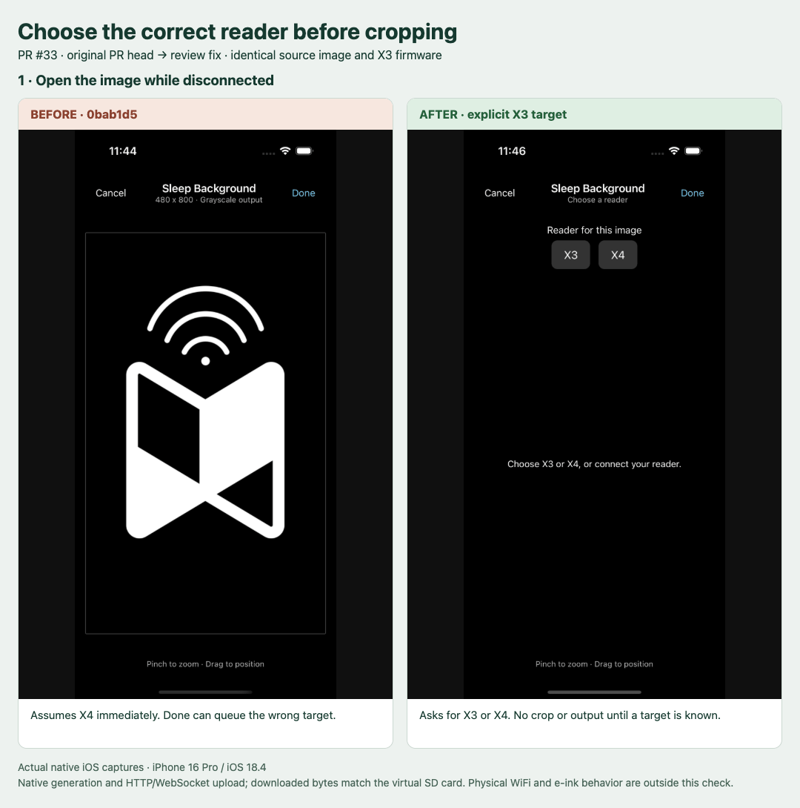

# Offline X3 crop review fix

The original PR head `0bab1d5` opened an offline crop at 480×800 and kept that
implicit X4 profile. The fix `8af47aa` waits for actual reader status or an explicit
X3/X4 choice. A chosen profile stays fixed so preview and output agree.

## Native app to firmware test

- iPhone 16 Pro simulator, iOS 18.4. Each production Hermes bundle ran in the same
  existing native release shell; no native source changed.
- The same source image (`assets/images/icon.png`, SHA-256
  `49ac54b1ef0ca661c8b8ec155b4f870b32363f87c9ef28f697f9779d4dea6f4d`)
  was staged in Documents and opened by the existing sleep-preview deep link.
  This bypassed photo selection only; native image manipulation, BMP encoding,
  persistent queue and HTTP/WebSocket upload ran through production app code.
- Firmware 2.0.0 `42d58daaabcf469a2e5e1ba871714fb9dcf51d29`, pinned SDK
  `5e94fe7480f019c89fbf691aef87523eb1b46704`, official simulator
  `04332e7ab5e048fe7909d6a788a9641ece14941b`, profile `simulator_x3` on macOS.
  Its existing build was reused after checking revisions and configuration.
- Each case used a fresh SD directory and custom sleep mode with fit placement.
  The app connected through manual loopback HTTP/WebSocket ports. Status reported
  X3. The app's uploaded BMP was downloaded through firmware HTTP and compared
  byte-for-byte with virtual SD storage before leaving File Transfer.
- After transfer, the simulator entered Sleep and loaded the uploaded file.
  The GIF combines actual native iOS and SDL screenshots, with explanatory labels.
  It is an animated comparison of captured states, not continuous video.

| Case | Native BMP | Bytes | Reader result |
| --- | --- | --- | --- |
| Before | 480×800, 24-bit grayscale | 1,152,054 | Firmware opens it and fits it with side margins. |
| After choosing X3 | 528×792, 24-bit grayscale | 1,254,582 | Firmware opens it at the X3 portrait aspect ratio. |

[Before headers/hashes](pr-33-offline-x3/before-results.json),
[after headers/hashes](pr-33-offline-x3/after-results.json),
[before firmware log](pr-33-offline-x3/before-firmware.log),
[after firmware log](pr-33-offline-x3/after-firmware.log),
[before SDL capture](pr-33-offline-x3/before-sleep.png),
[after SDL capture](pr-33-offline-x3/after-sleep.png), and the actual downloaded
BMPs ([before, gzip](pr-33-offline-x3/before-downloaded.bmp.gz),
[after, gzip](pr-33-offline-x3/after-downloaded.bmp.gz)) retain the evidence.

## Regression checks and limits

The actual component regression fails on the original PR. All 6 reader, 4 adaptive
and 17 book-format checks pass with the fix. Reader checks mount the actual crop
screen, update its real store, and inspect generated BMP headers using native
view/codec/filesystem boundary adapters; the native integration above separately
validates iOS codecs and transfer. Fresh iOS and Android exports pass. Maestro
verifies offline choice, cropping, queueing, upload, X3 identity and the connected
preview. Updated flows, visual specs and reviewed reference screenshots are in PR #33.

Full typechecking still reports the documented Tamagui RC prop diagnostics and
unchanged React Native filter style typing. Physical WiFi/UDP, FAT32 semantics,
reader memory ceilings, e-ink refresh and Android native codecs are outside this
simulator check. The original issue reporter's specific hardware/card empty-folder
symptom is not established by these tests.
